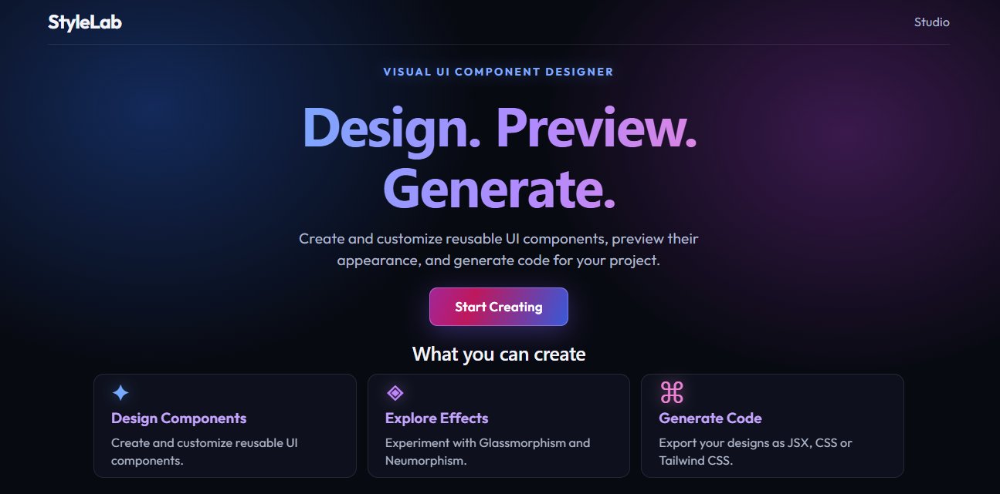
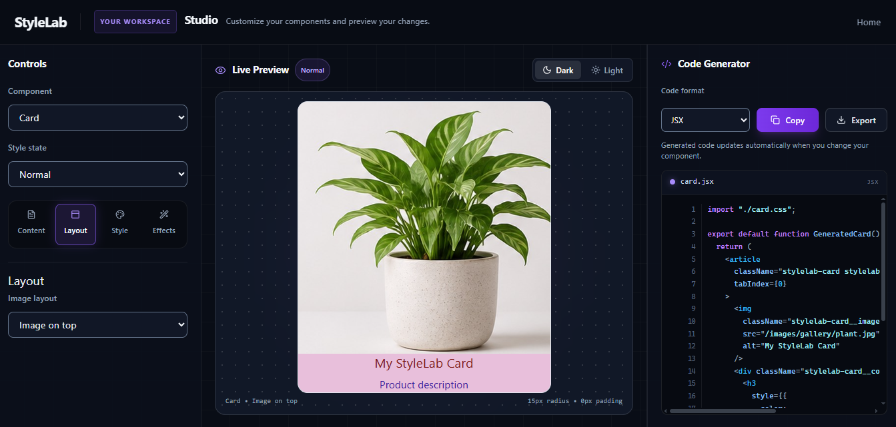
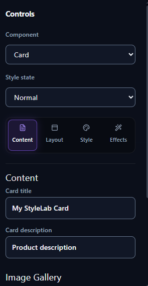
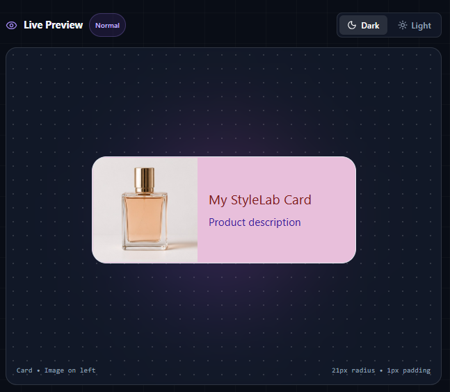
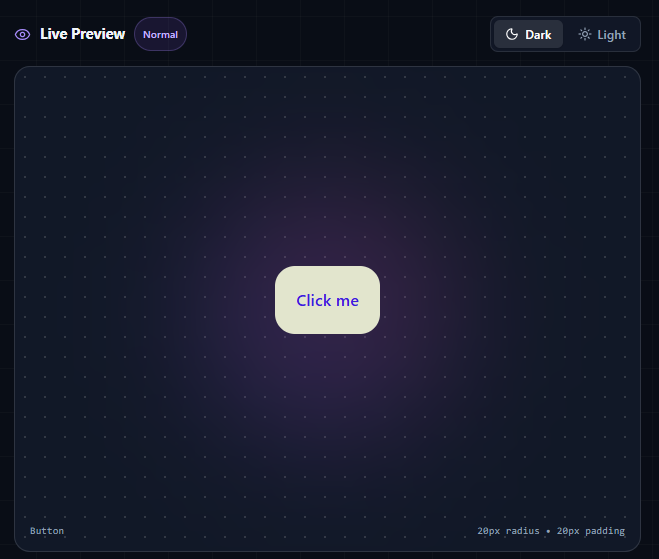
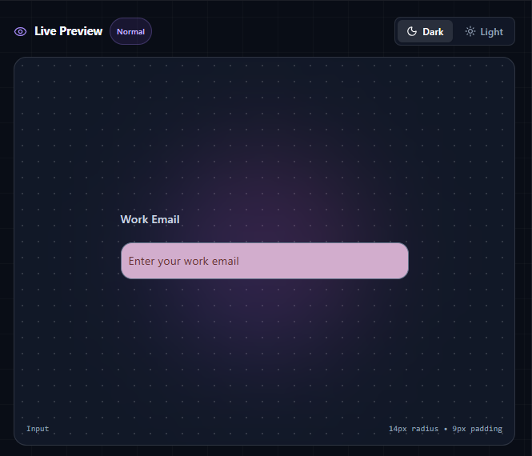
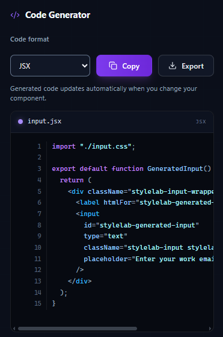

# StyleLab

_Design. Preview. Generate._

StyleLab is a visual UI component design studio built with React. It allows developers and UI designers to customize reusable UI components, preview their appearance in real time, and generate code ready to use in their projects.

## Overview

Creating reusable UI components often requires writing and adjusting CSS manually, switching between code and browser previews, and repeating styling changes across different components.

StyleLab provides a visual workspace that brings component customization, live preview, and code generation into one place.

The application is designed to make component styling more accessible and efficient without requiring users to manually write CSS for every design change.

## Features

### Component Customization

- **Card** - Customize title, description, image, and image layout.
- **Button** - Customize button text and appearance.
- **Input** - Customize label, placeholder, and appearance.

### Design Customization

- Customize background color and text color.
- Adjust border radius and padding.
- Apply Glassmorphism and Neumorphism effects.
- Preview interaction states: Normal, Hover, Focus, Disabled, and Error.
- Interaction states inherit the base styles defined in Normal.

### Image Gallery

- Choose from six built-in images.
- Preview the selected image in the Card component.
- Switch between top and left image layouts.

### Live Preview

- Preview component changes immediately.
- Switch between dark and light preview backgrounds.
- View the selected component with its content, styling, layout, and design effects.

### Code Generator

Generate reusable component code in three formats:

- **JSX** - React component with a corresponding CSS file.
- **CSS** - Standalone CSS styles.
- **Tailwind CSS** - React component using Tailwind utility classes.

Additional capabilities:

- Automatic code formatting using Prettier.
- Syntax highlighting using Prism.js.
- Copy generated code to the clipboard.
- Export generated code as a downloadable file.

### Workspace Persistence

- Automatically save workspace changes using browser LocalStorage.
- Restore saved workspace data when the application is reopened.
- Validate stored data before using it.
- Handle invalid or unavailable browser storage gracefully.

### Responsive Design and Accessibility

- Responsive layouts for desktop, tablet, and mobile screens.
- Keyboard navigation across the main application interfaces.
- Visible focus indicators.
- Accessible labels and semantic HTML.
- Accessible feedback messages for important actions.

## Screenshots

<p align="center">
  
  
</p>

<details>
<summary>More Screenshots</summary>

<p align="center">
  
  
</p>

<p align="center">
  
  
</p>

<p align="center">
  
</p>

</details>

## Technology Stack

| Technology            | Purpose                                 |
| --------------------- | --------------------------------------- |
| React 19              | Component-based UI development          |
| JavaScript            | Application logic                       |
| Vite 8                | Development server and production build |
| React Router 7        | Client-side navigation                  |
| Tailwind CSS 4        | Utility-first styling                   |
| CSS                   | Component styling and design effects    |
| Lucide React          | Interface icons                         |
| Prettier 3            | Generated code formatting               |
| Prism.js              | Syntax highlighting                     |
| Vitest 5              | Unit and component testing              |
| React Testing Library | UI testing                              |
| ESLint 10             | Code quality and linting                |
| npm                   | Dependency management                   |

## Project Structure

```text
stylelab/
|-- public/
|   |-- images/
|   |   `-- gallery/
|   `-- favicon.svg
|-- docs/
|   `-- screenshots/
|       |-- home.png
|       |-- studio.png
|       |-- controls.png
|       |-- card-gallery.png
|       |-- button.png
|       |-- input.png
|       `-- code-generator.png
|-- src/
|   |-- components/
|   |   |-- Button.jsx
|   |   |-- Card.jsx
|   |   |-- CodeGenerator.jsx
|   |   |-- ImageGallery.jsx
|   |   `-- Input.jsx
|   |-- context/
|   |   `-- WorkspaceContext.jsx
|   |-- data/
|   |   `-- imageGallery.js
|   |-- hooks/
|   |   `-- useWorkspace.js
|   |-- pages/
|   |   |-- Home.jsx
|   |   |-- Studio.jsx
|   |   `-- NotFound.jsx
|   |-- reducers/
|   |   `-- workspaceReducer.js
|   |-- styles/
|   |   `-- designEffects.css
|   |-- test/
|   |   `-- setup.js
|   `-- utils/
|       |-- codeExport.js
|       |-- codeGenerator.js
|       |-- formatGeneratedCode.js
|       |-- logger.js
|       `-- workspaceStorage.js
|-- .github/
|   `-- workflows/
|-- .gitignore
|-- eslint.config.js
|-- index.html
|-- package.json
|-- package-lock.json
|-- vite.config.js
`-- README.md
```

### Architecture Overview

- **Components** - Reusable UI components and the Code Generator.
- **Pages** - Home, Studio, and Not Found views.
- **Context** - Shared workspace state.
- **Hooks** - Reusable workspace logic.
- **Reducers** - Workspace state updates and validation.
- **Data** - Built-in image gallery definitions.
- **Styles** - Shared design effects.
- **Utils** - Code generation, formatting, exporting, storage, and logging.

The application uses React Context and Reducer for workspace state management, with LocalStorage for browser-based persistence.

## Getting Started

### Prerequisites

The project was developed and tested with:

- Node.js 24.18.0
- npm 11.16.0
- Git

Compatible versions of Node.js and npm are required to install and run the project.

### Installation

**1. Clone the repository**

```bash
git clone https://github.com/hanasolomon86-jpg/stylelab.git
```

**2. Navigate to the project directory**

```bash
cd stylelab
```

**3. Install dependencies**

```bash
npm ci
```

`npm ci` installs the exact dependency versions recorded in `package-lock.json`.

**4. Start the development server**

```bash
npm run dev
```

Open the local URL displayed in the terminal.

The default Vite development address is:

```text
http://localhost:5173/
```

## Available Scripts

| Command                 | Description                              |
| ----------------------- | ---------------------------------------- |
| `npm run dev`           | Start the development server             |
| `npm run build`         | Build the application for production     |
| `npm run preview`       | Preview the production build             |
| `npm run lint`          | Run ESLint                               |
| `npm run test -- --run` | Run all automated tests once             |
| `npm run test:watch`    | Run tests in watch mode                  |
| `npm run test:coverage` | Run tests and generate a coverage report |

## Testing

StyleLab uses Vitest and React Testing Library.

The automated test suite covers:

- Application routing.
- Component rendering and customization.
- Workspace state management.
- LocalStorage persistence and validation.
- Image Gallery selection.
- Code generation in all supported formats.
- Code formatting.
- Copy and Export operations.
- Logging behavior.

Run all tests once:

```bash
npm run test -- --run
```

Generate a Code Coverage report:

```bash
npm run test:coverage
```

The coverage report is generated in the `coverage/` directory.

## Code Quality

Run ESLint:

```bash
npm run lint
```

Create a production build:

```bash
npm run build
```

Preview the production build:

```bash
npm run preview
```

Check dependencies for known security vulnerabilities:

```bash
npm audit
```

## Workspace Storage

StyleLab uses the browser's LocalStorage API to persist workspace data.

The workspace is stored under the following key:

```text
stylelab-workspace
```

The storage utility is responsible for:

- Loading saved workspace data.
- Validating the workspace structure.
- Validating supported style properties and values.
- Normalizing stored component styles.
- Saving workspace changes.
- Handling storage errors.

Workspace data is stored locally in the browser and is not synchronized between devices or users.

## Logging

StyleLab includes a lightweight frontend logging utility located at:

```text
src/utils/logger.js
```

It supports three logging levels:

- `info` - Important application events.
- `warn` - Warnings and invalid data conditions.
- `error` - Application errors.

Log messages use the `[StyleLab]` prefix and are written to the browser console.

Logging is used for events such as:

- Workspace loading and saving failures.
- Code formatting failures.
- Syntax highlighting failures.
- Copy and Export operations.

The logging utility does not send data to an external monitoring service and does not log workspace content or generated code.

## Known Limitations

- Workspace data is stored locally in the browser; there is no cloud synchronization.
- The application does not include a backend or user authentication.
- The built-in image gallery contains a predefined collection of six images.
- Generated code is provided as a starting point and may require adjustments to match the destination project's environment and dependencies.
- Logging is limited to the browser console; external monitoring and centralized log storage are not included.

## Development Workflow

The project uses Git and GitHub for version control and task management.

The development workflow includes:

1. Create a dedicated branch for each task.
2. Implement the changes.
3. Run automated tests and quality checks.
4. Open a Pull Request.
5. Verify CI results and review the changes.
6. Merge approved changes into `main`.

GitHub Actions is used for Continuous Integration (CI).

## Repository

[GitHub - StyleLab](https://github.com/hanasolomon86-jpg/stylelab)
